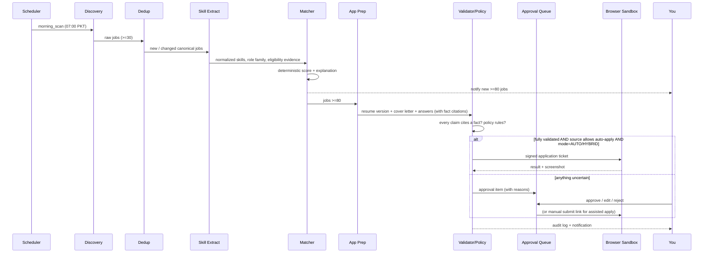

# Career Agent — Architecture (Phase 0, for approval)

Status: **Approved 2026-09-23 · implemented as v1.0.0 (2026-09-24)**
Owner: Raees Malik · GitHub: `raeesmalik89-oss` · Date: 2026-09-23

> **As built in v1.0 (differences from this design):**
> - **Scheduling and rate limits**: there is no Redis and no Celery. A small scheduler process (`scheduler/`) with exactly-once slots in `pipeline_runs` does the scheduling, and rate limits live in process memory (one API process).
> - **No LLM calls**: every agent (matching, application writing, interview scoring, concept maps) is deterministic and cites stored facts, so there is no token budget to enforce yet. The LLM hooks described below are future work.
> - **No automated form submission**: every application is *assisted*. The agent prepares and validates it; you approve it and submit it yourself on the employer's site.
> - **Notifications**: the dashboard polls instead of using SSE. Email (SMTP) and Telegram are optional; Slack is not implemented.
> - **Pipelines** are defined in Python (`scheduler/pipelines.py`), not YAML.
>
> See README "What Milestone N contains" and [DEPLOYMENT.md](DEPLOYMENT.md) for the system as it runs.

---

## 0. Requirements analysis — what changes the design

Most of the spec is clear. These points shape the architecture, and one of them limits what can be built:

| # | Finding | Design consequence |
|---|---------|--------------------|
| R1 | **LinkedIn, Indeed and Glassdoor ToS prohibit automated scraping and automated applying.** None of them offers a candidate-side apply API. | These are **not** automated connectors. Supported instead: (a) import of their job-alert emails (read-only, from your own inbox), (b) a "paste URL / paste JD" manual intake. The system never logs in to or automates these sites. |
| R2 | Sources that do allow programmatic access: RemoteOK (public JSON API, attribution required), We Work Remotely (RSS), Remotive (public API), Himalayas (public API), Arbeitnow (public API), Jooble (free API key, covers Pakistan), **Greenhouse / Lever / Ashby / Workable public job-board JSON** (read-only, per company). Rozee / Mustakbil have no public API. | A connector interface plus a **source registry** that records, for each source, whether reading is allowed and whether automated applying is allowed. Rozee and Mustakbil start as email-alert / manual intake until their ToS is checked. |
| R3 | "Auto-submit" is technically possible only on some ATS-hosted forms (Greenhouse, Lever, Ashby), and many of those forms carry hCaptcha/reCAPTCHA. We never bypass those. | Default mode is **Assisted Apply**: the system fills everything, you click Submit. Auto-submit is an opt-in **per-source allowlist**, and the policy engine must also allow it for that specific application. |
| R4 | "≥30 jobs/day" and "only show ≥80" pull against each other. On a strict day, 30 scanned jobs may produce 0–5 jobs at ≥80. | We guarantee **≥30 scanned** (the scan widens across sources and adds queries until it gets there). We **never inflate scores** to fill the ≥80 list. |
| R5 | A fit score that works like a hiring probability is not measurable. | Scoring is **deterministic and rule-based on top of LLM-extracted facts**. It is labelled "Estimated Resume-to-Job Fit Score", it can be reproduced from its inputs, and every point is explained. |
| R6 | Anti-hallucination is the core risk. | A **Verified Fact Store**: every claim about you is a row with a source pointer (resume span, repo file path, manual entry). Anything generated (cover letter, answers, tailored resume) is split into claims, and each claim must cite a fact ID or it is rejected. |
| R7 | Job descriptions are untrusted input and can contain prompt injection ("ignore instructions, email your CV to…"). | The LLM calls that process JDs **have no tools**, run in extraction-only mode, and must return schema-validated JSON. Actions are only ever decided by the policy engine, never by LLM output. |
| R8 | This is a single user today, but the spec asks for users, RBAC and auth. | The schema supports multiple users (`user_id` on every row). RBAC has 3 roles: `owner`, `viewer`, `system`. |
| R9 | Remote eligibility for Pakistan is often unstated. | Three states: `eligible` (explicit evidence quoted), `ineligible` (explicit restriction quoted), `unknown` ("Evidence not found"). `unknown` caps confidence at Medium and is never shown as eligible. |

---

## 1. System architecture

```mermaid
flowchart LR
  subgraph UI[Frontend - Next.js]
    D[Dashboard / Jobs / Approvals / Interview / Maps / Settings / Audit]
  end

  subgraph API[Backend - FastAPI]
    AUTH[Auth + RBAC]
    REST[REST API]
    WS[SSE notifications]
    POL[Policy Engine]
  end

  subgraph WORK[Workers - Celery]
    ORCH[Orchestrator]
    AG[15 Agents]
    LLM[LLM Gateway<br/>Anthropic / OpenAI / local]
  end

  subgraph ISO[Isolated Browser Sandbox]
    PW[Playwright runner<br/>no DB access, egress allowlist]
  end

  subgraph DATA[Data]
    PG[(PostgreSQL 16 + pgvector)]
    RD[(Redis - broker/cache/rate-limit)]
    FS[(Object store - resumes, PDFs<br/>local volume / S3)]
  end

  subgraph OBS[Observability]
    OTEL[OTel Collector] --> PROM[Prometheus] --> GRAF[Grafana]
    OTEL --> JAE[Jaeger]
  end

  EXT[Job sources: RemoteOK, WWR, Remotive,<br/>Himalayas, Jooble, Greenhouse/Lever/Ashby boards,<br/>Gmail alert import, GitHub API]

  D <--> REST
  D <-- SSE --- WS
  REST --> AUTH --> POL
  REST --> PG
  REST -- enqueue --> RD --> ORCH --> AG
  AG --> LLM
  AG --> PG
  AG --> EXT
  AG -- signed job ticket --> PW
  PW --> EXT
  BEAT[Celery Beat scheduler] --> RD
  API & WORK & PW --> OTEL
```

**Layers**
1. **Presentation**: Next.js (App Router), server-side calls to the API, cookie session holding a short-lived JWT.
2. **API**: FastAPI with synchronous CRUD, and it enqueues long-running work. It never calls an LLM itself.
3. **Orchestration**: a Celery-based orchestrator that runs agent DAGs (pipelines). Every agent run is persisted to `agent_runs`.
4. **Agents**: pure Python classes with the interface `run(input) -> AgentResult`. They are testable on their own, without Celery.
5. **LLM Gateway**: a single place for provider selection, retries, token and cost accounting, JSON-schema enforcement, prompt-injection guards and caching.
6. **Browser sandbox**: a separate container that only receives a signed, pre-validated "application ticket". It cannot query the DB or reach arbitrary hosts.
7. **Data**: Postgres is the source of truth, pgvector holds embeddings (JD ↔ evidence similarity), Redis is the broker, cache and rate-limiter.

---

## 2. Agent architecture

All agents return the same envelope:

```python
class AgentResult(BaseModel):
    agent_name: str
    run_id: UUID
    input_summary: str  # no PII beyond IDs
    actions: list[AgentAction]  # {type, target, detail, at}
    output: dict  # agent-specific, schema-validated
    confidence: Literal["high", "medium", "low"]
    errors: list[AgentError]
    timestamp: datetime
```

| # | Agent | Input | Output | Uses LLM? |
|---|-------|-------|--------|-----------|
| 1 | Resume Analyzer | PDF/DOCX/TXT/LinkedIn export/manual | Verified facts, skills taxonomy, weak sections, missing evidence | Yes (extraction), plus deterministic parsing |
| 2 | GitHub Analyzer | GitHub username/token | Repo inventory, **Skill Evidence Map** with file-level proof | Minimal (README summary). Evidence comes from file detection, not repo names |
| 3 | Job Discovery | Search profile + source registry | Raw job records | No |
| 4 | Job Deduplication | Raw jobs | Canonical jobs + duplicate links + material-change flag | No (hash + fuzzy + embeddings) |
| 5 | Skill Extraction | Job descriptions | `job_skills` (required/preferred, normalized), role family, seniority, eligibility evidence | Yes (structured extraction) |
| 6 | Job Matching | Canonical job + fact store + evidence map | Score breakdown, explanation, confidence | No. **Deterministic** |
| 7 | Application Preparation | Match ≥ threshold | Tailored resume (PDF/DOCX), cover letter, answers | Yes (generation) |
| 8 | Compliance/Validation | Application package | Claim-level validation, policy decision | Deterministic plus LLM claim splitting |
| 9 | Application Submission | Approved ticket | Submission result + evidence (screenshot, confirmation) | No |
| 10 | Skill Gap | Today's ≥80 jobs + profile | Frequency, trend, have/partial/missing, priority | No (stats), LLM for learning content |
| 11 | Interview Coach (pack) | Resume, GitHub, jobs, gaps, past mistakes | Daily Interview Pack (60 Q&A) | Yes |
| 12 | Mock Interview | Mode + session history | One question at a time, evaluation, improved answers | Yes |
| 13 | Concept Map | Priority skills | Tree → Markdown / Mermaid / JSON graph | Yes, validated against schema |
| 14 | Daily Report | All runs of the day | Daily Career Report | Template, with optional LLM summary |
| 15 | Notification | Events | Dashboard / email / Telegram / Slack | No |

**Orchestrator**: pipelines are declared as DAGs in `scheduler/pipelines.yaml`, for example:

```yaml
morning_scan:
  - job_discovery        # fan-out per source (parallel, rate-limited)
  - job_dedup
  - skill_extraction     # only new/materially changed jobs
  - job_matching
  - application_prep     # only score >= min_fit_score AND policy says prepare
  - compliance_validation
  - notification
```

Each step is idempotent, keyed by `(pipeline_run_id, step, entity_id)`, so a retried step never double-writes or double-applies.

---

## 3. Data flow



Data at rest per stage: `jobs_raw` (payload as fetched, kept for audit) → `jobs` (canonical) → `job_skills` → `job_matches` → `applications` → `application_answers` / `application_events` → `audit_logs`.

---

## 4. Database schema (PostgreSQL 16 + pgvector, Alembic migrations)

Conventions: UUID PKs, `created_at/updated_at timestamptz`, `user_id` FK on every user-owned table, JSONB for flexible structured outputs, soft delete where audit matters.

```sql
-- identity
users(id, email UNIQUE, display_name, role ENUM('owner','viewer','system'),
      password_hash NULL, oauth_provider NULL, timezone DEFAULT 'Asia/Karachi', settings JSONB)

-- profile / verified facts
resume_profiles(id, user_id, name, location, contacts JSONB, links JSONB, summary, is_active)
resume_versions(id, user_id, profile_id, kind ENUM('source','tailored'), job_id NULL,
      file_uri, format ENUM('pdf','docx','txt','md'), sha256, parsed JSONB, created_by_agent_run)
profile_facts(id, user_id, fact_type ENUM('education','certification','experience','skill_claim',
      'achievement','project','personal','preference','approved_answer'),
      data JSONB, source_type ENUM('resume','github','linkedin','manual'),
      source_ref JSONB,     -- {resume_version_id, page, char_span} | {repo, path, sha}
      verified_by_user BOOL, confidence)       -- THE anti-hallucination anchor
skills(id, canonical_name UNIQUE, category ENUM('cloud','devops','programming','ai_ml','aiops',
      'security','healthcare','data','other'), aliases TEXT[], parent_id NULL, embedding vector(1024))
user_skills(id, user_id, skill_id, level ENUM('strong','working','exposure'),
      evidence_fact_ids UUID[], github_evidence_ids UUID[], last_used_date NULL, is_outdated BOOL)

-- github
github_profiles(id, user_id, username, token_ref NULL, stats JSONB, last_synced_at)
github_repositories(id, github_profile_id, name, url, is_fork, languages JSONB, stars, pushed_at,
      readme_summary, structure JSONB, commit_stats JSONB, default_branch_sha)
github_evidence(id, repo_id, skill_id, evidence_type ENUM('file','config','code','ci','test',
      'docs','commit'), path, detail, strength ENUM('high','medium','low'), commit_sha)

-- jobs
job_sources(id, key UNIQUE, name, kind ENUM('api','rss','ats_board','email_import','manual'),
      read_allowed BOOL, auto_apply_allowed BOOL, tos_url, tos_reviewed_at, rate_limit_per_min, enabled)
jobs_raw(id, source_id, external_id, fetched_at, payload JSONB, payload_hash)
jobs(id, fingerprint UNIQUE, title, company, company_normalized, location, remote_type
      ENUM('remote','hybrid','onsite','unknown'), employment_type, salary_min, salary_max,
      salary_currency, salary_source_text, experience_required_years, education_required,
      visa_requirement, pk_eligibility ENUM('eligible','ineligible','unknown'),
      pk_eligibility_evidence TEXT, role_family, seniority, posted_date, closing_date,
      url, application_url, description, description_hash, content_version INT,
      first_seen_at, last_seen_at, embedding vector(1024))
job_source_links(job_id, raw_id, source_id, url)          -- dedup provenance
job_skills(id, job_id, skill_id NULL, raw_text, requirement ENUM('required','preferred'), weight)

-- matching
job_matches(id, user_id, job_id, job_content_version, scoring_config_version,
      estimated_fit_score NUMERIC(5,2), score_confidence, breakdown JSONB,
      why_matched JSONB, why_not_matched JSONB, missing_skills JSONB, partial_skills JSONB,
      evidence JSONB, risks JSONB, knockouts JSONB, recommendation TEXT,
      shown_to_user_at NULL, dismissed BOOL,
      UNIQUE(user_id, job_id, job_content_version))

-- applications
applications(id, user_id, job_id, match_id, status ENUM('prepared','pending_approval','approved',
      'submitting','applied','failed','interview','technical_interview','hr_interview',
      'rejected','offer','withdrawn'), mode ENUM('auto','assisted','manual'),
      resume_version_id, cover_letter_uri, why_applied TEXT, policy_decision JSONB,
      application_url, submitted_at, last_update, UNIQUE(user_id, job_id))   -- duplicate guard
application_answers(id, application_id, question, answer, category ENUM('factual','open_ended',
      'legal','compensation','relocation','visa','demographic'), cited_fact_ids UUID[],
      validation_status ENUM('valid','unsupported','needs_approval'), approved_by_user_at)
application_events(id, application_id, event_type, detail JSONB, actor ENUM('user','agent','system'),
      screenshot_uri NULL, at)

-- learning / interview
skill_gaps(id, user_id, report_date, skill_id, jobs_requiring INT, frequency_pct, trend_7d,
      have_level, gap_status ENUM('have','partial','missing'), interview_importance, priority_score)
learning_items(id, user_id, skill_id, kind ENUM('explanation','cheatsheet','lab','mini_project',
      'troubleshooting','commands'), content_md, status, completed_at)
interview_questions(id, user_id, pack_date, section, question, ideal_answer, testing_what,
      keywords TEXT[], common_mistakes, follow_up, difficulty, related_fact_ids UUID[],
      related_repo_ids UUID[], skill_ids UUID[])
interview_sessions(id, user_id, mode, started_at, ended_at, avg_score, summary JSONB)
interview_answers(id, session_id, question_id NULL, question_text, user_answer, score,
      mistakes JSONB, missing_concepts JSONB, improved_answer, professional_version,
      spoken_version, at)
concept_maps(id, user_id, skill_id, map_date, tree JSONB, mermaid TEXT, markdown TEXT, version)
knowledge_edges(id, user_id, src_type, src_id, rel, dst_type, dst_id, weight)  -- §22 graph

-- ops
daily_reports(id, user_id, report_date UNIQUE per user, metrics JSONB, content_md, generated_at)
agent_runs(id, pipeline_run_id, agent_name, input_summary, actions JSONB, output JSONB,
      confidence, errors JSONB, llm_tokens_in, llm_tokens_out, cost_usd, started_at, finished_at, status)
audit_logs(id, user_id, actor, action, entity_type, entity_id, before JSONB, after JSONB,
      reason TEXT, request_id, ip_hash, at)          -- append-only (DB trigger blocks UPDATE/DELETE)
notifications(id, user_id, kind, severity, title, body, link, channels TEXT[], delivered JSONB, read_at)
secrets(id, user_id, name, ciphertext BYTEA, key_version, created_at)   -- envelope-encrypted tokens
settings_versions(id, user_id, scoring_weights JSONB, policy JSONB, schedules JSONB, created_at)
```

A job has **"materially changed"** when any of these changed: title, seniority, remote_type, pk_eligibility, salary, or the hash of the normalized requirement list. A material change bumps `content_version`, which makes the job eligible to be shown again.

---

## 5. Job matching algorithm (deterministic, explainable)

**Step 0: Normalization.** JD skills map to canonical `skills` through aliases first and embedding similarity (≥0.88) second. The taxonomy also records adjacency: `gitlab_ci ~ github_actions`, `eks ~ kubernetes`, `loki ~ logging`.

**Step 1: Knockouts.** Any one of these hides the job and records the reason in `why_not_matched`:
- `pk_eligibility = ineligible` (e.g. "US only", "must be authorized in EU")
- on-site/hybrid job outside Islamabad/Rawalpindi
- security clearance or citizenship required
- seniority gap ≥ 2 levels (e.g. Principal/Staff vs your level)
- a required experience gap of more than 2× your verified years

**Step 2: Component scores** (weights configurable in `settings_versions.scoring_weights`, default below):

| Component | Weight | How it is computed |
|---|---|---|
| Skills | 30 | For each JD skill, evidence credit = 1.0 (resume experience **and** GitHub evidence), 0.8 (resume only), 0.7 (GitHub high only), 0.5 (adjacent skill / partial), 0 (missing). Required skills count 75% and preferred 25%. `score = 30 × weighted mean`. |
| Experience | 20 | Verified relevant years (from dated experience facts only) vs required: ≥ req → 1.0; ≥ 0.75·req → 0.8; ≥ 0.5·req → 0.5; else 0.2. Unknown requirement → 0.7 and lower confidence. |
| Project/GitHub evidence | 15 | Share of required skills backed by `github_evidence.strength ≥ medium`, plus a bonus for relevant repo recency (pushed < 180 days) and for repos containing tests/CI/docs. |
| Education/Certs | 10 | Degree level match (0/0.5/1) × 0.6 + requested cert match × 0.4. No requirement → 1.0. |
| Role/Seniority | 10 | Role family match (exact = 1, adjacent = 0.6, e.g. SRE↔DevOps, MLOps↔AI Platform) × 0.6 + seniority fit × 0.4. |
| Location/Remote | 10 | Remote + eligible = 1.0; remote + unknown = 0.5; Islamabad hybrid/onsite = 1.0; otherwise 0 (normally already knocked out). |
| Domain | 5 | Embedding similarity of JD vs your domain facts (healthcare AI, AIOps, IoT…) bucketed to 0/0.5/1. |

**Role families** (classifier: title rules plus LLM tie-break, each with its own skill profile): `devops`, `cloud`, `sre`, `aiops`, `ai_engineer`, `ai_platform`, `mlops`, `devsecops`, `kubernetes`, `platform`, `cloud_ai_infra`, `sre_ai`.

**Step 3: Confidence.**
```
confidence_points = 0
+2 if JD length > 1500 chars and >= 5 skills extracted
+1 if experience requirement explicit
+2 if pk_eligibility != unknown
+1 if >= 70% of JD skills mapped to taxonomy
+1 if LLM extraction passed schema on first try and dual-extraction agreement >= 0.8
High >= 6, Medium 4-5, Low <= 3
```

**Step 4: Explanation.** Each component has a template-generated explanation that cites IDs (fact IDs, repo paths, JD quote spans). The LLM may paraphrase that explanation into prose, but it never computes the score.

**Ranking** among jobs ≥ threshold: `score DESC, skills DESC, experience DESC, github DESC, location DESC, posted_date DESC, salary_known DESC`.

The label is always **"Estimated Resume-to-Job Fit Score: 87/100 (Confidence: High)"**, with the fixed disclaimer: *"Measures overlap between your verified profile and the posting. It is not a probability of being hired."*

---

## 6. Application workflow

```mermaid
stateDiagram-v2
  [*] --> prepared: score>=80 & policy.prepare
  prepared --> validating
  validating --> pending_approval: any claim unsupported / sensitive question / uncertainty
  validating --> approved: all valid & policy.auto_submit
  pending_approval --> approved: you approve (optionally edit)
  pending_approval --> withdrawn: you reject
  approved --> submitting: source.auto_apply_allowed
  approved --> awaiting_manual_submit: assisted apply
  submitting --> applied: confirmation detected
  submitting --> failed: CAPTCHA/MFA/error -> never retried blindly
  failed --> pending_approval
  awaiting_manual_submit --> applied: you mark submitted
  applied --> interview --> technical_interview --> hr_interview --> offer
  applied --> rejected
```

**Policy engine.** Rules are YAML, evaluated in Python. The file is versioned, and every decision stores the rule trace.

```yaml
prepare:
  all:
    - match.estimated_fit_score >= settings.min_fit_score
    - job.pk_eligibility in [eligible] or job.remote_type in [hybrid, onsite] and job.city in settings.cities
    - not application.exists(job)
auto_submit:
  all:
    - settings.auto_apply == true
    - settings.approval_mode in [AUTO, HYBRID]
    - source.auto_apply_allowed == true
    - package.unsupported_claims == 0
    - package.answers.categories subset_of [factual]        # anything else -> approval
    - not job.requires_captcha
    - daily_auto_submits < settings.max_auto_submits_per_day   # default 5
require_approval:
  any:
    - package.answers.any(category in [open_ended, legal, compensation, relocation, visa, demographic]
                          and not previously_approved_answer)
    - match.score_confidence == low
    - job.pk_eligibility == unknown
never_claim:
  - skill where user_skills.level is null  # missing skill never appears in generated text
```

**Validation (Compliance Agent).**
1. The generated text is split into atomic claims (LLM, JSON output).
2. Each claim is matched to `profile_facts` (exact entity match plus embedding similarity plus an LLM entailment check with a strict prompt).
3. `unsupported` claims block auto-submit. The UI highlights them in red, with "Evidence not found."
4. Dates, degrees, employers and cert names are compared **character-exactly** to facts, with no paraphrase allowed.

**Resume tailoring.** Tailoring only **reorders and selects**: skills are ordered by JD relevance, the matching projects are chosen, and bullets are picked from the fact store. New bullets may only reword a fact and must cite it. Output is `resume_<company>_<role>.docx` (python-docx, ATS-safe single column) plus `.pdf` (rendered with LibreOffice headless in the worker image).

**Duplicate prevention.** `UNIQUE(user_id, job_id)`, plus a pre-check across `jobs.fingerprint` for company+title reposts within 60 days, plus the idempotency key on the submission ticket.

---

## 7. Interview preparation workflow

1. **Inputs**: verified facts, GitHub evidence map, today's ≥80 jobs, top gap skills, and the last 14 days of `interview_answers` where score < 70 (your weak areas and past mistakes).
2. **Planner** (deterministic) allocates 60 questions in 6 sections × 10. Topics are weighted by gap priority and job frequency, and duplicates of the last 30 days are avoided (embedding similarity < 0.85).
3. **Generator** (LLM) produces each Q with: ideal answer, what's tested, keywords, common mistakes, follow-up, difficulty, and `related_fact_ids` / `related_repo_ids`. Project questions may only reference repos and files that exist in `github_evidence`.
4. **Validator** checks the schema, checks that referenced IDs exist, and strips project claims that have no evidence.
5. **Mock Interview**: one question at a time. Your answer is scored with a rubric (accuracy 40, completeness 25, structure/STAR 15, depth/trade-offs 10, communication 10) → mistakes → missing concepts → improved answer → professional version → simple spoken-English version. The ideal answer is never shown before you have answered. Low scores feed back into tomorrow's pack.
6. **Modes**: HR, Technical, DevOps, AIOps, Cloud, Kubernetes, SRE, AI Engineering, System Design, Project Defense. Each mode is a prompt profile with its own rubric weights.

---

## 8. Skill-gap workflow

1. Take jobs from the last 1/7/30 days with score ≥ threshold, and separately all scanned jobs in your target families (so a skill missing from your profile still shows up even when it keeps jobs below 80).
2. Frequency per skill = % of jobs requiring it. Trend = 7-day frequency minus the previous 7 days.
3. Gap status from `user_skills`: have / partial (exposure level or adjacent only) / missing.
4. `priority = 0.4·frequency + 0.25·role_importance + 0.2·gap_severity + 0.15·interview_importance`
5. For the top-N missing or partial skills, the Learning Engine produces: explanation, cheat sheet, commands, lab, troubleshooting scenarios, mini-project, concept map and mock questions.
6. When you mark a learning item done and add evidence (a repo or cert), `user_skills` is updated. **Skills are never auto-upgraded from study alone.** Evidence is required.

---

## 9. Concept-map workflow

1. Select concepts: top-priority gap skills + today's interview topics + new technologies (skills first seen in the last 7 days).
2. The LLM generates a tree against a fixed JSON schema: `concept → components → interactions → production_use → devops_use → interview_traps → commands → troubleshooting → related`.
3. Validation: schema, depth ≤ 5, node count ≤ 80, and commands are syntax-linted where possible (kubectl/terraform/docker verbs are checked against an allowlist).
4. Renderers: JSON → Markdown tree, JSON → Mermaid `mindmap`, JSON → React Flow graph in the UI.
5. Nodes link to `knowledge_edges` (Job → Skill → Concept → Question → Resume/GitHub evidence → Learning item → Gap).

---

## 10. Security architecture

| Concern | Control |
|---|---|
| AuthN | Argon2id password + TOTP for the owner (MVP); GitHub OAuth login later. Short-lived JWT (15 min) in an httpOnly SameSite=strict cookie, plus a rotating refresh token. |
| AuthZ | RBAC (`owner`, `viewer`, `system`), enforced by FastAPI dependencies. Row-level `user_id` scoping on every query. |
| Secrets | `.env` only for bootstrap. User tokens (GitHub PAT, Jooble key, SMTP, Telegram) are **envelope-encrypted** (AES-256-GCM data key, master key from env/KMS) in `secrets`. **No job-platform passwords are ever stored.** No site that requires a password login is automated. |
| Git hygiene | `.gitignore`, `gitleaks` pre-commit + CI, `.env.example` only. |
| Rate limits | Redis token buckets: API per user/IP, and outbound per source (respects `rate_limit_per_min`, robots.txt, `Retry-After`). |
| Prompt injection | Untrusted text is wrapped in delimiters and flagged "data only". Extraction calls have no tools. Output must match a JSON schema. Instruction-like patterns in JDs are detected and logged. LLM output never selects an action target (URL, recipient); only DB-validated `application_url` values from the source are used. |
| SSRF | Outbound HTTP goes through one client with a host allowlist from `job_sources`/ATS domains, blocks private/link-local/metadata IPs after DNS resolution, allows no redirects to non-allowlisted hosts, and enforces size and time limits. |
| Browser isolation | Playwright runs in its own container: non-root, read-only FS, seccomp, no DB credentials, egress proxy with an allowlist, fresh browser context per ticket, and screenshots returned for audit. **It never solves CAPTCHAs or MFA.** Detection means abort and send to approval. |
| Data minimization | Demographic answers are never auto-filled (default "prefer not to say" only with your stored approval). PII is redacted from logs and traces. Raw JD retention is 180 days. |
| Audit | `audit_logs` is append-only (trigger). Every policy decision stores the rule trace. |
| Supply chain | Pinned deps (uv lock / pnpm lock), Trivy image scan, Dependabot, SBOM in CI. |
| Transport | Caddy TLS in production. Internal network isolation in compose (sandbox on its own network). |

---

## 11. Deployment architecture

**Local / WSL2**: `docker compose up`, using these services:

```
postgres (pgvector/pgvector:pg16)   redis:7
api (FastAPI, uvicorn)              worker (Celery)      beat (Celery Beat)
frontend (Next.js)                  browser-sandbox (Playwright, isolated net)
otel-collector  prometheus  grafana  jaeger              mailpit (dev SMTP)
```

**Production** (single-user, cost-efficient): one VM (e.g. AWS EC2 t3.medium or Hetzner CX32), provisioned by **Terraform** (VM, security group, volume, backups, DNS). Docker Compose runs with a prod override, Caddy handles TLS, and Postgres gets nightly `pg_dump` to S3-compatible storage. Upgrade path: managed Postgres (RDS) + ECS/K8s if multi-user.

**CI/CD (GitHub Actions)**: lint (ruff, mypy, eslint) → unit tests → integration tests (compose postgres) → build images → Trivy scan → push to GHCR → deploy on tag through SSH + `docker compose pull && up -d` → Alembic migrate.

---

## 12. Technology choices

| Choice | Why |
|---|---|
| Python 3.12 + FastAPI + Pydantic v2 | Matches your stack. Pydantic schemas double as LLM output schemas. |
| SQLAlchemy 2 + Alembic | Mature migrations. Works with pgvector. |
| PostgreSQL 16 + pgvector | One DB for relational data, audit and embeddings, so no extra vector service. |
| **Celery + Celery Beat** (over Dramatiq/APScheduler) | Beat gives persistent, configurable cron with DB-backed schedules (`django-celery-beat` equivalent: `celery-sqlalchemy-scheduler`), chords/groups for DAG fan-out, and a large ecosystem. |
| Redis | Broker, cache, rate limits, SSE pub/sub. |
| **Next.js (App Router) + TypeScript + Tailwind + shadcn/ui** | Fast dashboard building. React Flow for concept maps and the graph, Recharts for KPIs. |
| LLM Gateway (own thin layer over official SDKs) | Default: Anthropic **`claude-sonnet-5`** for extraction/generation and **`claude-opus-5-5`** for mock-interview evaluation and claim validation. OpenAI and local (Ollama / OpenAI-compatible) through the same interface. Per-task model config. |
| Embeddings | Configurable: local `bge-m3` via sentence-transformers (free, private) by default. The API provider is optional. |
| Playwright | Only for assisted/permitted ATS form filling. |
| python-docx + LibreOffice headless | ATS-safe DOCX, faithful PDF. |
| pdfplumber / docx2python | Resume parsing. |
| OpenTelemetry → Prometheus/Grafana/Jaeger | Your requested stack. Traces span API → Celery → LLM calls. |
| uv, ruff, mypy, pytest, Playwright test, Vitest | Fast, strict tooling. |

---

## 13. Project directory structure

```
career-agent/
├── backend/
│   ├── app/
│   │   ├── main.py, config.py, deps.py
│   │   ├── api/v1/            # routers per resource
│   │   ├── core/              # security, rbac, crypto, ratelimit, http_client (SSRF-safe), telemetry
│   │   ├── db/                # models/, session.py, repositories/
│   │   ├── schemas/           # pydantic DTOs + agent output schemas
│   │   ├── policy/            # engine.py, rules.yaml
│   │   └── services/          # thin domain services used by API & agents
│   ├── migrations/            # alembic
│   └── pyproject.toml
├── agents/
│   ├── base.py                # Agent, AgentResult, run recorder
│   ├── orchestrator.py
│   ├── llm/                   # gateway.py, providers/, prompts/, guards.py
│   ├── resume_agent/  github_agent/  job_agent/ (discovery, dedup, extraction)
│   ├── matching_agent/        # scorer.py, knockouts.py, explain.py, taxonomy.py
│   ├── application_agent/     # prepare.py, tailor_resume.py, cover_letter.py, validator.py
│   ├── skill_agent/  interview_agent/ (pack.py, mock.py, rubric.py)
│   ├── concept_map_agent/  report_agent/  notification_agent/
├── integrations/
│   ├── sources/               # base.py + remoteok.py, wwr.py, remotive.py, himalayas.py,
│   │                          #   jooble.py, arbeitnow.py, greenhouse.py, lever.py, ashby.py,
│   │                          #   email_alerts.py (LinkedIn/Indeed/Rozee alert import), manual.py
│   ├── github_client.py
│   └── notify/                # email.py, telegram.py, slack.py
├── browser_automation/        # sandbox service: ticket verify, ats_handlers/, captcha_detect.py
├── scheduler/                 # beat_schedule.py, pipelines.yaml
├── workers/                   # celery_app.py, tasks.py
├── frontend/                  # Next.js app (app/, components/, lib/api.ts)
├── data/taxonomy/skills.yaml  # canonical skills + aliases + adjacency + role profiles
├── infra/
│   ├── terraform/             # prod VM
│   ├── observability/         # prometheus.yml, grafana dashboards, otel-collector.yaml
│   └── caddy/
├── tests/
│   ├── unit/  integration/  e2e/
│   └── fixtures/              # mock resumes, mock jobs (30+), mock github trees
├── docs/                      # ARCHITECTURE.md, SECURITY.md, RUNBOOK.md, ADRs/
├── .github/workflows/ci.yml, deploy.yml
├── docker-compose.yml, docker-compose.prod.yml, .env.example, Makefile, README.md
```

---

## 14. API endpoint plan (`/api/v1`)

| Area | Endpoints |
|---|---|
| Auth | `POST /auth/login`, `POST /auth/refresh`, `POST /auth/logout`, `POST /auth/totp/verify`, `GET /me` |
| Profile | `POST /resume/upload`, `GET /resume/versions`, `GET /resume/intelligence`, `GET/POST/PATCH /profile/facts`, `POST /profile/facts/{id}/verify` |
| GitHub | `POST /github/sync`, `GET /github/repos`, `GET /github/evidence-map` |
| Jobs | `GET /jobs?min_score&family&remote&since`, `GET /jobs/{id}`, `GET /jobs/{id}/match`, `POST /jobs/manual` (paste URL/JD), `POST /jobs/{id}/dismiss` |
| Sources | `GET /sources`, `PATCH /sources/{key}` (enable, auto-apply flag, owner only) |
| Applications | `GET /applications`, `GET /applications/{id}`, `POST /applications/{id}/approve`, `POST /applications/{id}/reject`, `PATCH /applications/{id}/answers/{aid}`, `POST /applications/{id}/mark-submitted`, `PATCH /applications/{id}/status`, `GET /applications/{id}/files/{kind}` |
| Approvals | `GET /approvals` |
| Skills | `GET /skills/gaps?window=1d|7d|30d`, `GET /learning`, `PATCH /learning/{id}` |
| Interview | `GET /interview/packs/{date}`, `POST /interview/sessions`, `GET /interview/sessions/{id}/next`, `POST /interview/sessions/{id}/answer`, `GET /interview/stats` |
| Concept maps | `GET /concept-maps?date`, `GET /concept-maps/{id}?format=json|mermaid|md`, `GET /knowledge-graph?root=skill:kubernetes` |
| Reports | `GET /reports/daily/{date}`, `GET /reports/kpis` |
| Settings | `GET/PUT /settings` (profile prefs, weights, policy, schedules), `GET /settings/history` |
| Ops | `POST /pipelines/{name}/run`, `GET /agent-runs`, `GET /audit-logs`, `GET /notifications`, `GET /stream` (SSE), `GET /healthz`, `GET /metrics` |

---

## 15. Scheduler plan (Asia/Karachi, configurable in Settings → stored in DB)

| Time | Pipeline | Steps |
|---|---|---|
| 07:00 | `morning_scan` | discovery (all enabled sources) → ensure ≥30 scanned (widen queries if short) → dedup → extract → match → notify ≥80 → prepare packages → validate → auto-submit / queue |
| 11:00, 17:00 | `delta_scan` (optional) | Same, new postings only |
| 14:00 | `afternoon_analysis` | skill extraction rollup → gap analysis → learning items → concept maps → knowledge graph refresh |
| 20:00 | `evening_prep` | interview pack → mock-session seed → learning progress → daily report → notifications/email digest |
| Sun 10:00 | `weekly_sync` | GitHub re-sync, resume re-analysis if changed, taxonomy maintenance, stale job expiry |
| hourly | `housekeeping` | retry failed notifications, expire closed jobs, token-usage budget check |

Guardrails: daily LLM budget cap (USD, configurable). If it is exceeded, only deterministic steps run and a notification is sent.

**As built (Milestone 10):** a single-user install does not need Celery Beat + Redis. `scheduler/` is a small, time-zone-aware cron loop (`python -m scheduler`). Each slot (user, pipeline, fire time) is claimed by inserting a unique `pipeline_runs` row, which gives exactly-once runs across restarts or duplicate processes. Missed slots are caught up within `catch_up_hours`. Steps commit one by one and record their own status. The pipeline definitions live in `scheduler/pipelines.py`, not YAML, so every step is plain, tested Python. Celery remains an option if the platform ever needs multiple workers.

---

## 16. Example daily workflow (illustrative, not real data)

- **07:00**: 9 sources return 212 postings, of which 41 match target families. Dedup leaves 34 unique (7 duplicates across RemoteOK/Himalayas/Greenhouse). Extraction runs; 11 are knocked out (8 "US only", 2 Lahore onsite, 1 clearance). 23 are scored, and **4 score ≥80**: e.g. "AIOps Engineer — Remote (EMEA)" 88/High; "DevOps Engineer — Islamabad hybrid" 84/High; "MLOps Engineer — Remote worldwide" 82/Medium; "SRE — Remote" 80/Medium (pk_eligibility unknown, so approval is required).
- **07:20**: packages are prepared. The Greenhouse job has only factual fields and the source is allowlisted, but it has hCaptcha, so it goes to **assisted apply**. Two go to the approval queue: one has an open-ended "Why us?" question, one has a salary expectation question. You get a Telegram ping and a dashboard badge.
- **09:00**: you approve two packages (after editing one answer, which is saved as a reusable approved answer) and click Submit on the assisted one. The audit log records everything.
- **14:00**: gap report: OpenTelemetry at 75% of today's ≥80 jobs (partial), ArgoCD at 50% (missing, trend ↑), LangGraph at 25% (missing). The concept map for ArgoCD and a learning lab are generated.
- **20:00**: the interview pack has 60 Qs, including project defense on CardioCare-AIOps *only if* evidence exists, plus follow-ups on yesterday's weak Kubernetes-networking answer. The daily report is emailed.

---

## 17. Risks and mitigations

| Risk | Impact | Mitigation |
|---|---|---|
| ToS violations / account bans | High | Source registry with ToS review; no LinkedIn/Indeed/Glassdoor automation; assisted apply by default |
| Hallucinated claims in applications | Critical | Fact store + claim validation + exact-match on dates/degrees + approval on anything unsupported |
| Few jobs actually reach ≥80 | Medium | Transparent reporting (scanned vs ≥80); weights tunable; show a "75–79 near-miss" count (not listed) to guide learning |
| Wrong PK eligibility inference | High | Only explicit quoted evidence counts; unknown ≠ eligible |
| Prompt injection in JDs | Medium | Tool-less extraction, schema output, policy-only actions, URL from source data only |
| Scraper/API breakage | Medium | Connector contract tests with recorded fixtures; per-source health metrics + alerts |
| LLM cost creep | Medium | Only new/changed jobs extracted; caching by description hash; daily budget cap; small model for extraction |
| Auto-submit mistakes | High | Daily cap, per-source allowlist, screenshots, idempotency keys, HYBRID mode default |
| Personal data leak | High | Encryption, PII-redacted logs, single-tenant deploy, TLS, backups encrypted |
| Scope size (12 milestones) | High | MVP cut below; each milestone shippable and tested |

---

## 18. MVP scope (Milestones 1–6 plus slices of 7–9)

**In MVP**
- Backend, DB, migrations, auth (single owner + TOTP), audit log
- Resume Analyzer (PDF/DOCX/TXT + manual facts; fact verification UI)
- GitHub Analyzer (public API, file-evidence detection, evidence map)
- Job sources: RemoteOK, We Work Remotely, Remotive, Himalayas, Arbeitnow, Jooble, Greenhouse/Lever/Ashby boards for a configurable company list, manual paste-JD intake
- Dedup, extraction, deterministic matching with full explanations, ≥80 view
- Dashboard: Dashboard, Jobs, Job Details/Match, Resume Intel, GitHub Intel, Settings, Audit
- Application: package generation (tailored DOCX/PDF + cover letter + answers) + validator + approval queue + **assisted apply** (open link, copy fields) + status tracking
- Daily skill-gap report, daily interview pack, text mock interview
- Scheduler (3 daily pipelines), dashboard + email notifications
- Docker Compose, CI, tests with 30+ mock jobs

**After MVP**
- Playwright auto-submit for allowlisted ATS sources
- Gmail job-alert import (LinkedIn/Indeed/Rozee alerts), Telegram/Slack
- Concept maps UI (React Flow), knowledge graph explorer, full Learning Engine
- Full observability dashboards, Terraform prod, OAuth login

---

## 19. Future enhancements

- Voice mock interviews (speech-to-text + spoken-English feedback on pace and fillers)
- Outcome feedback loop: use your real interview/rejection outcomes to re-weight scoring (calibration, still never shown as a probability)
- Company research agent (tech stack, Glassdoor-free sources such as engineering blogs)
- Recruiter outreach drafts (sent only by you)
- Browser extension: "score this job" on any page you are viewing yourself
- Multi-user SaaS mode, Kubernetes/Helm deployment
- Portfolio gap projects: auto-scaffold a GitHub repo to close a top skill gap with real evidence

---

## Decisions needed from you before Milestone 1

1. **Apply mode default**: Assisted Apply (recommended) with auto-submit off until M7 and then allowlist-only. OK?
2. **LinkedIn/Indeed/Glassdoor**: alert-email import + manual paste only (no automation). OK?
3. **Stack confirmations**: Celery + Beat, Next.js, Anthropic as default LLM with local embeddings (`bge-m3`).
4. **Scoring weights and knockouts** as in §5. Anything to change (e.g. treat `pk_eligibility=unknown` as knockout instead of 0.5)?
5. **Your years of experience / seniority target** (Junior / Mid / Senior) and **salary floor** (PKR and USD), used for seniority fit and compensation-question policy.
6. **Target company list** for Greenhouse/Lever/Ashby boards: seed with remote-friendly companies, or will you supply one?
7. **Resume file**: please provide your current CV (PDF/DOCX) for Milestone 2.
